# Intelligent Candidate Discovery & Ranking — Implementation Plan

Rank the **top 100** best-fit candidates out of **100,000** for ONE role: **Senior AI Engineer — Founding Team** at Redrob AI. Output a CSV. That's the whole task.

This plan reflects facts **verified against the real 100,000-candidate `candidates.jsonl`** and against all organizer docs (JD, submission spec, signals doc, schema).

---

## 1. The Core Strategy (one line)

Only ~726 of 100,000 candidates even have an AI/ML title. So this is a **filtering problem first, ranking problem second**: throw out the obvious junk with cheap rules, then carefully score the few hundred real candidates with a **transparent weighted feature model** where embedding similarity is just ONE feature (~14% in the final version), not the backbone.

### Why embeddings are NOT the spine
- **80% of the grade is the top 50** (`0.50×NDCG@10 + 0.30×NDCG@50 + 0.15×MAP + 0.05×P@10`). Getting the ordering of the best ~150 people right is everything.
- We started with a 384-dim MiniLM and later upgraded to bge-base (768-dim), but even the stronger model barely separates the #3 candidate from the #15 on this templated data (measured strong-vs-weak gap ~0.04) — and that ordering is exactly where the points live. So embeddings stay a semantic tie-breaker, not the spine.
- The dataset contains "behavioral twins": profiles stuffed with the right keywords whose own descriptions admit weakness ("production was handled by the platform team", "lighter weight than ranking systems at FAANG"). Embeddings love them; a feature scorer that reads the JD's real disqualifiers rejects them.
- Everything must be **explainable** for the Stage-5 defend-your-work interview. "The feature weights ranked them" is defensible; "the cosine put them there" is not.

---

## 2. Verified Dataset Facts (from the real 100K file)

| Finding | Count | Use |
| :--- | :--- | :--- |
| Candidates with an ML/AI/DS-ish title | **726 / 100,000** | The "needles" are <1% — filter aggressively |
| Honeypot: Krutrim start < 2023 (founded Dec 2023) | **38** | Hard filter → score 0 |
| Honeypot: Sarvam start < 2023 (founded 2023) | **36** | Hard filter → score 0 |
| Honeypot: ≥3 skills "expert" with `duration_months == 0` | **21** | Hard filter → score 0 |
| Consulting-only careers (TCS/Infosys/Wipro/etc.) | **9,745** | Hard filter → score 0 |
| Foreign (`country != India`) AND `willing_to_relocate == False` | **17,756** | Hard filter → score 0 |
| Non-eng title (Marketing/HR/Sales/etc.) + AI skills (stuffers) | **4,931** | Hard filter → score 0 |
| Title-chasers (≥4 jobs, ≥3 tenures < 20 months) | **5,019** | Penalty (not zero) |
| Have any `skill_assessment_scores` | **24,244** (only 24%) | Bonus when present — **never penalize absence** |
| `last_active_date` in 2025 / 2026 | **31,472 / 68,528** | Recency = continuous decay, **NOT** "2025 = dead" |

> Today is **2026**. Do not treat a 2025 last-active date as automatically stale.

---

## 3. The Target Profile (what "Senior AI Engineer" means HERE)

The JD is explicit. The right answer is matching the *meaning*, not the title/keywords.

**Must have:** production embeddings-based retrieval, vector DB / hybrid search, strong Python, ranking evaluation (NDCG/MRR/MAP/A-B).
**Ideal:** 6–8 yrs total, 4–5 in applied ML at **product** companies, shipped a ranking/search/recommendation system, in or willing to relocate to **Noida/Pune**, **active** (reachable).
**Explicitly NOT wanted:** title-chasers · LangChain-tutorial/framework enthusiasts · consulting-only · CV/speech/robotics without NLP/IR · research-only without production · architecture/tech-lead who hasn't coded in 18 months.

---

## 4. Hackathon Rules & Constraints

### Runtime constraints (the `rank.py` step only)
- **Runtime:** ≤ 5 minutes wall-clock
- **Memory:** ≤ 16 GB RAM
- **Compute:** CPU only — no GPU
- **Network:** OFF — no API calls (OpenAI/Anthropic/Gemini/etc.). Fully self-contained.
- **Disk:** ≤ 5 GB intermediate state
- Precomputation (embeddings) is allowed offline with **no** time limit; only `rank.py` must fit the budget.

### CSV format (auto-rejected on any violation — run `validate_submission.py`)
- Filename: `<registered_participant_id>.csv`, UTF-8
- Columns in exact order: `candidate_id,rank,score,reasoning`
- Exactly **100 data rows** + 1 header
- `candidate_id` matches `^CAND_[0-9]{7}$` and exists in `candidates.jsonl`
- Ranks: unique integers 1–100; scores **non-increasing** by rank; ties broken by `candidate_id` **ascending**

### Honeypot rule
Submissions with **>10% honeypots in the top 100 are disqualified** at Stage 3.

---

## 5. Architecture — Two Phases

### Phase 1 — Offline Precompute (your PC, no time limit)
1. Read `candidates.jsonl` (100K).
2. Per candidate, build text blob = `summary + headline + all career-history descriptions`. **NO skills list** (that's how stuffers game it).
3. Encode with a local sentence-transformer. Started with `all-MiniLM-L6-v2`
   (384-dim); upgraded to `BAAI/bge-base-en-v1.5` (768-dim) for better retrieval
   quality (the JD names BGE/E5). GPU used if available — offline, no time limit.
4. Save `candidate_embeddings.npy` (~293 MB for bge-base) + `candidate_ids.npy`.
5. Embed the JD once (with the BGE query prefix) → `jd_embedding.npy`.
6. Ship the embeddings via Git LFS so the ranking step needs no model or network.

### Phase 2 — `rank.py` (≤5 min, CPU, no network)
1. Load `candidates.jsonl` + `candidate_embeddings.npy` + `jd_embedding.npy`.
2. **Hard filters** → score 0 (see §6).
3. **Feature score** for survivors (see §7).
4. **JD penalties** (see §8).
5. **Behavioral multiplier** (see §9).
6. Sort desc; ties by `candidate_id` ascending; take top 100.
7. Generate **specific, varied, honest** reasoning (see §10).
8. Write `<participant_id>.csv`; run `validate_submission.py`.

---

## 6. Hard Filters (cheap rules, score → 0)

- **Honeypot — company founding:** keep `company_founded = {"krutrim":2023, "sarvam":2023, ...}`; flag any `start_year < founded_year`.
- **Honeypot — fake experts:** ≥3 skills `proficiency == "expert"` AND `duration_months == 0`.
- **Consulting-only:** every company in career history ∈ consulting set.
- **Can't relocate:** `country != "India"` AND `willing_to_relocate == False`.
- **Buzzword stuffer:** title clearly non-engineering (Marketing/HR/Sales/Graphic/Accountant/Civil/Mechanical…) AND claims core AI skills.

---

## 7. Feature Score (survivors only, 0–1)

Embedding similarity is ONE input, not the boss.

| Feature | Measures | Weight |
| :--- | :--- | :--- |
| `title_role_match` | Current/recent title is really ML/AI/DS/eng | **0.24** |
| `career_evidence` | Descriptions mention retrieval/ranking/search/recommendation/NLP | **0.22** |
| `embedding_similarity` | cosine(JD, career text) — coarse semantic match | **0.14** |
| `experience_fit` | 5–9 yrs ideal; soft penalty outside (JD says it's a range) | **0.12** |
| `product_vs_services` | Bonus product companies; penalty services | **0.10** |
| `skill_trust` | `duration_months × endorsements`, capped | **0.08** |
| `assessment_bonus` | Relevant Redrob assessment present → bonus (never penalize absence) | **0.05** |
| `writes_code_recently` | Penalize architecture/tech-lead-only with no recent code | **0.05** |

---

## 8. JD-Specific Penalties (free points)

Soft penalties (reduce score, don't zero out):
- **Title-chaser:** ≥4 jobs with ≥3 tenures < 20 months.
- **LangChain-only:** only recent LangChain/OpenAI work, no pre-2022 real ML.
- **CV/speech/robotics-only:** no NLP/retrieval exposure.
- **Research-only:** academic titles, no "production/deployed/shipped/users/scale" in descriptions.

---

## 9. Behavioral Multiplier (~0.5–1.1)

Multiply feature score by "can we actually hire them":
- `recruiter_response_rate` — low = unreachable = big down-weight.
- `last_active_date` — decay by **months since active** (today 2026), not a 2025 cutoff.
- `open_to_work_flag`, short `notice_period_days` — small bonuses.

Multiplier, not a filter: a great-but-slightly-less-active candidate shouldn't drop to zero, but a 5%-response-rate candidate effectively does.

---

## 10. Reasoning Column (Stage-4 make-or-break)

Spec penalizes templated/name-insert reasoning; samples 10 rows for variety, specificity, honest concerns, tone-matches-rank. Each reasoning must:
1. Name **specific evidence** (company + what they built).
2. Connect to a **JD requirement**.
3. For lower ranks, **name the concern** honestly ("strong retrieval background but 120-day notice").
Vary sentence structure. Never invent a skill/company not in the profile.

---

## 11. Master Flowchart

```mermaid
flowchart TD
    Start([START]) --> P1

    subgraph P1["🔵 PHASE 1 — OFFLINE PRECOMPUTE (no time limit)"]
        direction TB
        L1[Load candidates.jsonl 100K] --> L2[Text blob = summary + headline + career descriptions<br/>NO skills list]
        L2 --> L3[Local bge-base-en-v1.5, cache weights]
        L3 --> L4[Encode → 768-dim vectors]
        L4 --> L5[Save candidate_embeddings.npy ~293MB]
        L3 --> L6[Embed JD with query prefix → jd_embedding.npy]
        L5 --> L7[Commit artifacts via Git LFS]
        L6 --> L7
    end

    P1 --> P2
    subgraph P2["🟢 PHASE 2 — rank.py (≤5 min · CPU · 16GB · NO network)"]
        direction TB
        R1[Load data + embeddings] --> R2{HARD FILTER}
        R2 -->|Honeypot / Consulting-only /<br/>No-relocate / Stuffer| KILL[score = 0]
        R2 -->|Survivor ~5–10K| FEAT[FEATURE SCORE 0–1]
        FEAT --> PEN[− JD penalties]
        PEN --> BEH[× behavioral multiplier]
        KILL --> SORT
        BEH --> SORT[Sort desc; ties → candidate_id asc]
        SORT --> TOP[Top 100]
        TOP --> REAS[Reasoning: specific + varied + honest]
        REAS --> CSV[Write &lt;participant_id&gt;.csv]
    end

    CSV --> VAL[Run validate_submission.py] --> VCHK{Valid?}
    VCHK -->|No| CSV
    VCHK -->|Yes| D

    subgraph D["🚀 DEPLOY & PACKAGE"]
        direction TB
        DEPLOY[Streamlit / HF Space sandbox<br/>ranks ≤100 sample] --> META[submission_metadata.yaml<br/>+ AI-tools declaration]
        META --> README[README: single reproduce command]
        README --> SLIDES[Explainer PDF]
        SLIDES --> COMMITS[Incremental git history]
    end

    COMMITS --> SUBMIT[📤 Submit: CSV + repo + sandbox + metadata]
    SUBMIT --> J

    subgraph J["⚖️ JUDGING"]
        S1[1 Format validate] --> S2[2 Score hidden truth<br/>NDCG@10/50 + MAP + P@10]
        S2 --> S3[3 Re-run in sandbox + honeypot ≤10%]
        S3 --> S4[4 Manual review: reasoning + git]
        S4 --> S5[5 30-min defend interview]
    end

    S5 --> WIN([🏆 RESULT])

    style P1 fill:#d6e9ff,stroke:#0366d6
    style P2 fill:#d6ffd9,stroke:#28a745
    style KILL fill:#ffd6d6,stroke:#d73a49
    style J fill:#fff3cd,stroke:#d4a017
    style WIN fill:#c3f7c3,stroke:#28a745,stroke-width:2px
```

---

## 12. Deliverables (miss one = rejection)

1. **`<participant_id>.csv`** — exact format; validated locally.
2. **GitHub repo** — clean code, `requirements.txt`, README with single reproduce command. **Commit incrementally** (Stage 4 checks git history).
3. **`submission_metadata.yaml`** at root — honest AI-tools declaration (declaring Claude is NOT penalized).
4. **Sandbox / demo link (REQUIRED, live URL)** — free HuggingFace Space / Streamlit Cloud app that ranks a ≤100 sample end-to-end, CPU-only, no network. (Colab/Docker recipe also acceptable.) Missing = Stage-1 flag.
5. **Explainer PDF** — methodology slides.

---

## 13. Build Order

1. `rank.py` skeleton + **hard filters** → produces a legal 100-row CSV fast.
2. Add **feature scoring** + **behavioral multiplier**.
3. Add **precompute.py** (embeddings + JD vector).
4. Add **reasoning** generation.
5. Build **Streamlit/HF sandbox** (deployed link).
6. **Slides + metadata + final validation**.

---

## 14. Verification Plan

1. `python validate_submission.py <participant_id>.csv` — structural check.
2. Sanity-check top 10: no honeypots, no consulting-only, no title mismatches, reasoning tone matches rank.
3. Confirm honeypot rate in top 100 is ~0% (must be < 10%).
4. Use `sample_candidates.json` for quick local iteration.
